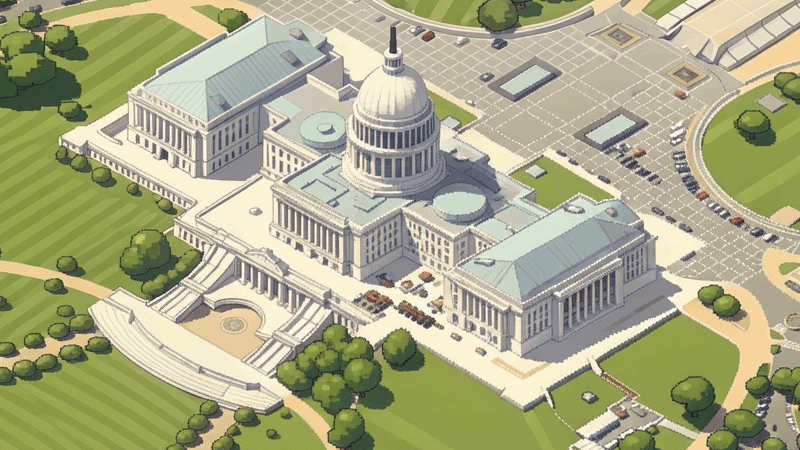
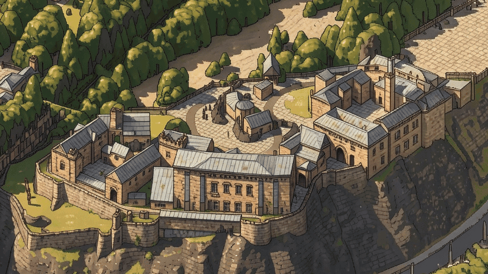

# Isometric cities

Real neighbourhoods as isometric pixel-art maps, made on your Mac by you and a coding agent.

[](examples/dc.png)

[](examples/edinburgh.png)

[Watch DC](https://github.com/Statecraft-Labs/isometric-cities/releases/download/v0.4.2/washington-dc.mp4) · [Make your city](https://github.com/Statecraft-Labs/isometric-cities/releases/download/v0.4.2/make-your-city.mp4)

## Ask for your city

Give your coding agent this:

```text
Clone https://github.com/Statecraft-Labs/isometric-cities and follow its AGENTS.md.
Make an isometric map of [CITY/AREA]. Review one accurate patch, then expand it.
```

Your agent sources real data, reviews a styled patch, then grows the map and exports an explorer and a film. Rendering and inference run locally on Apple Silicon; 128 GB tested, about 9 GB of weights.

Quality depends on available data. `make "PLACE"` starts with untextured geometry; the agent improves it before painting. The bundled native painter repainted the whole Edinburgh example from a fresh clone: 10 windows in 24 minutes, 18 GB at peak. A fresh coding agent given this README also used it to make a new Amsterdam map, from source capture to finished explorer and film, in about an hour with the models already downloaded. Smaller Macs are untested. [Method and limits](docs/workflow.md).

## Explore the examples

```sh
git clone --depth 1 https://github.com/Statecraft-Labs/isometric-cities.git
cd isometric-cities && ./setup.sh && python3 atlas.py demo --open
```

No models needed. Drag, pinch, jump between landmarks, compare each map with its source.

[Agent guide](AGENTS.md) · [Workflow](docs/workflow.md) · [Sources](docs/sources.md) · [How the examples were made](examples/README.md)

Code is MIT. The default Klein 9B weights are non-commercial. Maps and data keep [their own licences](THIRD_PARTY_NOTICES.md).
