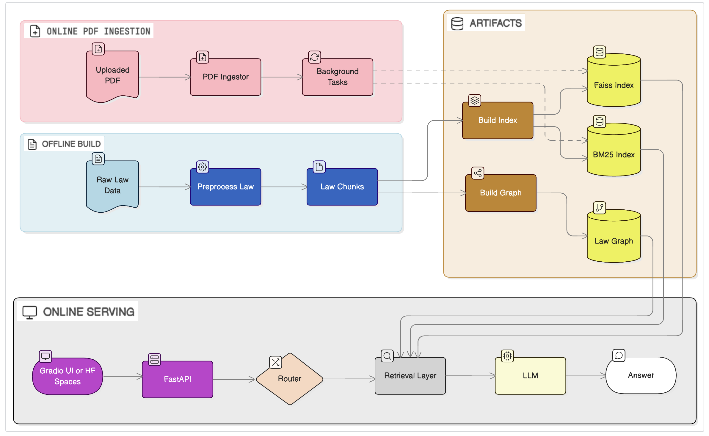

[](https://huggingface.co/spaces/flora-l/Legal-RAG)
[](https://www.kaggle.com/code/fanlcs/retrieval-performance-evaluation)
[](https://colab.research.google.com/drive/1TRp4d_VwlcSY8f78psuCNX_90WA3g6qS?usp=sharing)
[](https://www.apache.org/licenses/LICENSE-2.0)
 

## What is Legal-RAG?
[Legal-RAG](https://fan-luo.github.io/Legal-RAG/) is an open-source, end-to-end legal Retrieval-Augmented Generation (RAG) system centered on statutory text. It integrates QueryType-aware routing, hybrid retrieval, bounded graph-augmented context expansion, and provider-agnostic generation. Running OpenAI models with an OPENAI_API_KEY as the generation model is optional; you can deploy with GPU to enable local models (default: Qwen), and other open-source models are configurable.

<video src="docs/project.mp4" width="720" height="480" controls muted style="display: block; margin: 0 auto 50px auto;"></video>


## Online Demo  

- Option 1 — Hosted Demo: [Hugging Face Spaces](https://huggingface.co/spaces/flora-l/Legal-RAG) (no GPU, slower, requires OpenAI key)
- Option 2 — Self‑Launch Demo: [Colab notebook](https://colab.research.google.com/drive/1bDlIFzHvnlR-U3lWVGLJAGq3KwcpvlxG?usp=sharing) (launch the server on GPU, no OpenAI key required)


<a class="github-video">https://github.com/user-attachments/assets/1a380d62-d909-480a-8618-a03f3015e1bd</a>


## Features

### Law-aware RAG
- Explicit article-level chunking
- Law-specific metadata (chapter / section / article number)
- Retrieval results are inspectable and auditable
- Language-aware corpus routing (zh/en)

### Hybrid Retrieval
- Dense retrieval: FAISS
- Sparse retrieval: BM25
- ColBERT (late interaction)
- Weighted fusion

### Query Routing & Graph Awareness
- Lightweight law_graph for structural reasoning
- Router decides between:
  - pure retrieval
  - graph-assisted RAG
- Clear extension point for richer legal knowledge graphs

### Online PDF Ingestion (Incremental Indexing)
- Upload PDFs → parse → chunk → JSONL
- Incremental FAISS add
- BM25 rebuild in background
 

## System Architecture
The system is organized into four clearly separated layers:

1. Offline Build
  Law text preprocessing, index construction, graph building

2. Index Artifacts
  FAISS, BM25, and law_graph as immutable read models

3. Online Ingestion
  PDF upload → background incremental indexing

4. Online Serving (RAG + Routing)
  FastAPI + RagPipeline + Router + LLM

See the architecture diagram for the full data flow.



 
## Populated demonstration case

[Open the fictional Northstar case](https://sb-5pdq64fn7m57.vercel.run/ui/demo-case.html): six exhibits, seven question flows and an optional scanned PDF for OCR. This is temporary hosting; see [CLOUD-PREVIEW.md](CLOUD-PREVIEW.md). For fresh installations, follow [DEMO-CASE.md](DEMO-CASE.md) to seed the real backend.

## English installation

This branch preserves the original chat, citations, PDF upload and API-key interface, with English-only published screens, an English corpus and English answer instructions. See [INSTALL-ENGLISH.md](INSTALL-ENGLISH.md) for requirements, validation and deployment limitations.

### Docker (Windows, macOS or Linux)

```bash
cp .env.example .env
# Optional: configure OPENAI_API_KEY securely in .env.
docker compose up --build -d
```

Open http://localhost:7860/. First startup downloads models and builds all indexes; allow several minutes. The `legal-rag-runtime` volume preserves models, uploaded documents and indexes. Docker Desktop must use Linux containers. The Docker recipe is provided; this installation was tested directly with Python, not by building the Docker image.

### Python 3.12 (Linux)

Install a C++ compiler, Ninja, Tesseract English OCR and Poppler, then:

```bash
python3.12 -m venv .venv
. .venv/bin/activate
pip install torch==2.5.1+cpu --index-url https://download.pytorch.org/whl/cpu
pip install -r requirements.txt -c constraints-cpu.txt --extra-index-url https://download.pytorch.org/whl/cpu
export OPENAI_MODEL=gpt-4o-mini
sh scripts/start_english.sh
```

The English installer automatically prepares `law_en.jsonl`, FAISS, BM25, ColBERT and the legal graph. Search works without a generation key. For AI answers, enter your own OpenAI key in the original interface or configure one on the server. The upstream multilingual corpus and code remain in the source for provenance; the published English installation does not index the Chinese corpus.

## Example

```python
from legalrag.config import AppConfig
from legalrag.pipeline.rag_pipeline import RagPipeline

cfg = AppConfig.load()
pipeline = RagPipeline(cfg)

question = "What standards must goods satisfy to be merchantable？"
ans = pipeline.answer(question)

print(ans.answer)
``` 

## LLM Backends & Cost Model
Supported backends:

- Local LLM (Qwen series, need GPU and enough memory)
- OpenAI-compatible API (need to provide OpenAI API key)
  - A user can enter a key in the original UI (browser session storage).
  - The key is sent to this backend and OpenAI for generation; it is not written to disk.
  - A server-managed key can alternatively be supplied in an environment variable.
Note: If no key is provided and no local model loaded, the system gracefully degrades


## Project Structure

```
Legal-RAG/
│
├── legalrag/
│   ├── __init__.py
│   ├── config.py                   
│   ├── schemas.py                 # LawChunk / RetrievalHit / RoutingDecision / RagAnswer
│   ├── llm/
│   │   ├── __init__.py
│   │   ├── gateway.py
│   │   └── client.py              # Qwen / OpenAI LLMClient 
│   │
│   ├── routing/
│   │   ├── __init__.py
│   │   ├── legal_issue_extractor.py
│   │   └── router.py              # QueryType + Graph/RAG Suggestions
│   │
│   ├── retrieval/
│   │   ├── __init__.py
│   │   ├── builders
│   │   ├── dense_retriever.py     # Dense (BGE + FAISS)
│   │   ├── vector_store.py        
│   │   ├── bm25_retriever.py      # Sparse (BM25 + jieba)
│   │   ├── colbert_retriever.py
│   │   ├── hybrid_retriever.py    # Dense + Sparse + Colbert + Graph + Rerank
│   │   ├── by_lang_retriever.py   # zh/en routing
│   │   ├── corpus_loader.py       # read all chunks from processed_dir
│   │   ├── incremental_indexer.py
│   │   ├── graph_retriever.py
│   │   ├── graph_store.py         # law_graph / legal_kg  
│   │   └── rerankers.py
│   │
│   ├── pdf/
│   │   ├── __init__.py
│   │   └── parser.py              # pdfplumber + OCR fallback
│   │
│   ├── ingest/
│   │   ├── __init__.py
│   │   ├── orchestrator.py
│   │   ├── service.py
│   │   ├── task_queue.py
│   │   └── ingestor.py            # PDFIngestor 
│   │
│   ├── pipeline/
│   │   ├── __init__.py
│   │   └── rag_pipeline.py        # Graph-aware RAG Core Inference
│   │
│   ├── prompts/
│   │   ├── prompt_zh.json         # Chinese prompt
│   │   └── prompt_en.json         # English prompt
│   │
│   ├── utils/
│   │   ├── __init__.py
│   │   ├── lang.py
│   │   ├── logger.py             
│   │   └── text.py                
│   │
│   └── api/
│       ├── __init__.py
│       └── server.py              # FastAPI（/rag/retrieve, /rag/answer, /ingest/pdf）
│
├── ui/
│   ├── index.html
│   └── demo.qmd
│
├── scripts/
│   ├── preprocess_law.py          # parse law → LawChunk JSONL
│   ├── build_index.py             # FAISS + BM25 + Colbert indexes
│   ├── build_graph.py             # law_graph / legal_kg  
│   ├── bgenerate_synthetic_data.py
│   └── evaluate_retrieval.py      # Hit@K / MRR / nDCG
│
├── notebooks/
│   ├── 01_Launch_the_UI.ipynb
│   ├── 02_LegalRAG_Pipeline.ipynb
│   ├── 03_Retrieval_Performance_Evaluation.ipynb
│   └── 04_Law_Graph_Visualization.ipynb
│
├── data/
│   ├── raw/                         
│   │   ├── minfadian.txt            
│   │   └── ucc/                    
│   ├── processed/                 # law_zh.jsonl / law_en.jsonl
│   ├── index/                     # faiss/bm25/colbert per language
│   └── graph/                     # law_graph_zh.jsonl / law_graph_en.jsonl
│   └── eval/
│       
├── docs/
│   ├── architecture.mmd
│   └── architecture.png
│ 
├── tests/
│   ├── test_router.py
│   └── test_retrieval.py
│ 
├── README.md
├── README-zh.md
├── LICENSE
├── pyproject.toml
├── requirements.txt
├── _quarto.yml
├── index.qmd
├── app.py                           # Hugging Face Space entry
├── Dockerfile
└── .gitignore                       

```


## Who is this project for?
This repository is intended for:

- Engineers exploring RAG system design
- Researchers working on legal NLP / AI + law
- Practitioners interested in traceable AI systems
- Candidates demonstrating architecture-level thinking

> ⚠️ This project provides legal information assistance for educational and research purposes only and does not constitute legal advice. Users should not rely on this project as a substitute for professional legal counsel. The authors and contributors disclaim any liability for any direct or indirect consequences arising from the use of this project.

 

## Extensibility

Legal-RAG is intentionally structured to support:

- richer legal knowledge graphs
- multi-document reasoning
- multi-tenant isolation
- BYOK (Bring Your Own Key) SaaS models

These are architectural affordances, not product promises.


## License
Apache License 2.0

This repository contains source code only.
Users are responsible for complying with the licenses of any models or APIs they choose to integrate.
