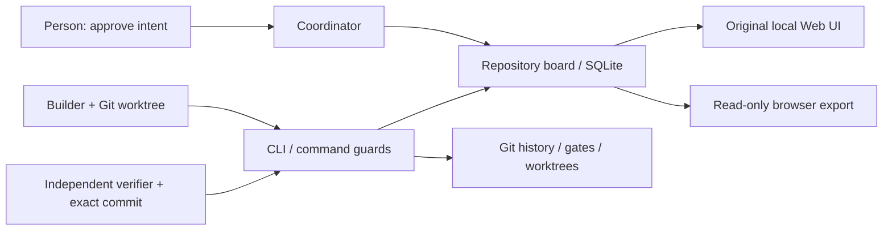

# Pullboard v0.9.3 technical reference

## Scope and provenance

Reference repository: https://github.com/pullboard-dev/pullboard. Stable commit: `c3c21438ebda51fc410519b23cdea68801b1bb79`; annotated release tag v0.9.3. This is an implementation map and parity baseline, not a claim that all upstream tests or every integration have been exercised. Official README, package metadata, CLI commands, lifecycle declaration, API/formats documentation, relay architecture, tour and exported UI were inspected. Exact documentation and source are available in the pinned submodule. Main at inspection was `6231e10d4f22673b41ec5797a642b7b6f8e9fd06`; this delivery uses the stable commit instead.

## Product contract

Pullboard coordinates coding agents around a repository, a human-approved specification, bounded lanes and independent review. It does not itself supply an LLM or a code editor. The person approves intent; the coordinator deals and lands work; builders implement in Git worktrees; verifiers inspect the exact submitted commit. Its board UI exposes work and evidence rather than replacing an IDE. A similar system must preserve these responsibilities and refusal semantics, not merely reproduce columns.

## Runtime and architecture

Plain JavaScript ES modules, Node >=22.13, native `node:sqlite`, Git; no third-party runtime package dependencies or build step. `bin/pullboard.js` dispatches command modules in `src/commands/`; `src/machine.js` declares guarded state transitions. Repository-local persistence uses a single SQLite board in the Git common directory, shared across worktrees. Committed `pullboard.json` defines lanes, gates and policy; approved spec/doctrine remain versioned. Local serving/export is in `src/serve.js`; original browser assets are shipped by upstream. Optional `relay/` implements separately hosted authenticated coordination and sealed records; the static export does not include that runtime.

## Domain and workflow

Main entities: repository board, registered agent/seat and declared model/family, lane ownership, approved spec row, item, dependencies, claim lease, frozen criterion digest, submitted commit, verifier reservation, verdict, merge/landing receipt, ordered event and shout/decision. Additional subsystems cover doctrine, roadmap, code maps, proof statistics, focused tests, runners, resources and sentinels. See `docs/formats.md` and `docs/api.md` for exact stored/API schemas; copy these versioned contracts rather than inventing incompatible fields.

Usual path: approved row → open item → leased claim → build and green submission at pinned commit → independent reserved review → accept → coordinator merge and record landing. Reject returns work to open; lease expiry releases claims; withdrawal is terminal. The complete lifecycle also includes intake, rehome, refreeze, reopen and submit-merge paths: `docs/lifecycle.md` and `src/machine.js` are authoritative. All entry points must apply equivalent guards and transaction/identity checks. Self-verification, stale criteria, wrong worktree/session, unreviewed stacks and unsupported transitions must fail with actionable refusal codes. Different scripted sessions are not evidence of different autonomous models.

## Original interaction surfaces

The v0.9.3 exporter includes Home, Items, Shouts, Spec, Doctrine, Activity, Roadmap and Settings. Items have inspection and filtering; board/project switching, theme controls and a console are native surfaces. Snapshot mode adds replay controls and visibly identifies its read-only state. UI settings/actions are capability-dependent; their presence does not prove live writes or relay configuration. On a real local board the view talks to the local versioned HTTP API; snapshot mode fetches exported relative JSON and refuses writes. Preserve this original UI first; alternative interfaces should consume the documented API rather than fork transition rules.

## Interface and integration inventory

- CLI: init/help, spec/doctrine, lane/worktree/join/takeover, add/claim/submit/reserve via next/verify/reject, land/merged/ledger, shouts/decisions, roadmap, stats/flow, gates/test/runners/resources, import/export/view/serve, run/loop/watch and MCP command families. Exact accepted arguments come from the pinned help/API, not this overview.
- Agent orchestration: model/family labels and session binding support external Codex/Claude seats; run/loop may dispatch configured external executables. No credentials or coding models are bundled.
- Git integration: lane ownership, commit/gate policy and review-at-commit checks. Hooks are cooperative controls, not an OS sandbox; agents execute code under the user's permissions unless separately isolated.
- Optional relay: GitHub identity, machine/agent credentials, paired browser device keys and encrypted board records. It needs separate deployment/authentication; no relay was activated here.
- Optional runners/sandbox providers: environment-dependent gate execution; these are not automatically established by opening the UI.

## Feature status for this delivery

| Capability | Status | Cause / impact / action |
|---|---|---|
| Original exported UI | Working and tested | Official exporter succeeded; navigation and replay tested. Theme pointer issue recorded; read-only design. |
| Git build/reject/fix/review/merge tour | Working and tested | Official deterministic seats executed actual commands; no model inference. |
| Persistent local board | Working and tested | Tour used SQLite across separate command processes; browser export preserved. Full service restart not separately tested. |
| Spec/lane/session safeguards exercised by tour | Working and tested | Bounded demo policy only; not exhaustive guard coverage. |
| Remaining CLI and live local UI writes | Installed but not tested | Full pinned source available; run original CLI on configured repository. |
| Autonomous Codex/Claude coding | Requires external credentials/service | Configure supported CLI and approved model access; absence prevents autonomous work. |
| Own project policy/spec | Requires user configuration | Define gates, ownership and approval before implementation. |
| MCP/remote runners/sandbox providers | Optional and intentionally not enabled | Requires explicit integration configuration; no obstacle to local board viewing. |
| Relay, phone pairing and cross-machine sync | Optional and intentionally not enabled | Separate authenticated service; hosted snapshot cannot substitute. |
| Windows 10 native runtime | Blocked by environment | This is Linux cloud; PC access and Windows compatibility not verified. |
| Built-in LLM/chat model | Not included in selected release | Pullboard is the coordination layer; bring an external coding agent. |

## Development parity and extensions

To build a compatible alternative, first reproduce atomic lifecycle transitions and refusal codes; Git-common-dir state sharing; frozen acceptance criteria; identity/session/lane enforcement; exact-commit review; dependency/lease handling; ordered audit events; deterministic exports; API identity checks; and the original operational screens. Validate using real temporary Git repositories and SQLite, including two worktrees and rejection/rework. UI-only cards cannot establish parity.

Suggested additions, not upstream claims: provider-neutral agent adapter protocol, per-task spend caps, explicit network/filesystem sandbox profiles, accessible tablet workspace, exportable evidence bundles, project template catalog and legal-document project workflows. Keep model dispatch, tool execution and board authority separate. An e-signature platform could be governed as a project with separate PDF, consent/audit and UI lanes, but this tour implements a greeter, not an e-signature product.

## Verification and limits

See `evidence/`. No claim is made of exhaustive API/relay/security testing, production readiness, completed model-backed website development or a Windows installation. Upstream release/docs links are resolved from the pinned repository; its source and actual browser export are the interface reference. Any future reproduction should retain MIT attribution and label independently authored extensions.
